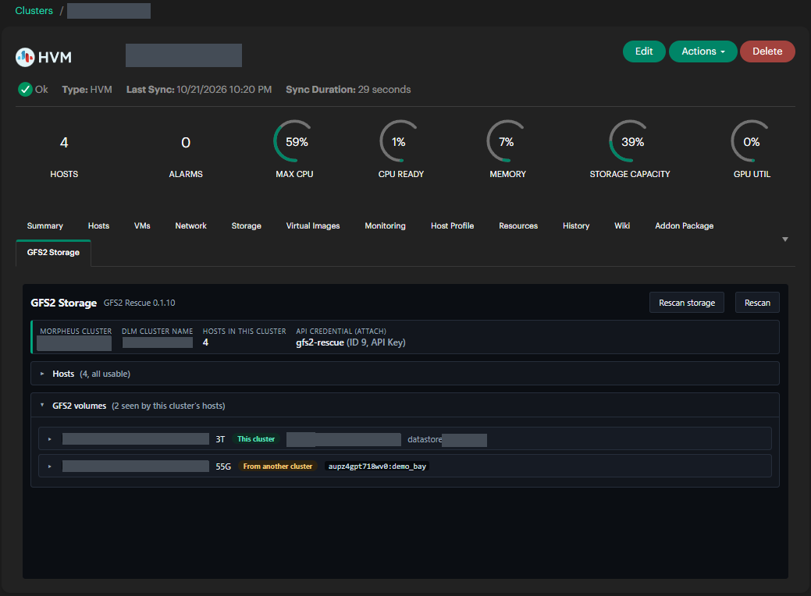

# Overview

GFS2 Rescue lets an HVM cluster take over a GFS2 volume that another cluster created, keep
everything on it, and attach it as an HPE Clustered Datastore, without the reformat Morpheus
otherwise asks for.

## Why it exists

An HVM cluster keeps shared storage on GFS2: one filesystem on a LUN that every host mounts at the
same time, coordinated by the cluster's DLM (distributed lock manager). Each GFS2 filesystem records
which cluster it belongs to in its **lock table**, written `<cluster name>:<filesystem name>`. A
host only mounts a GFS2 volume whose lock table names its own cluster.

So when the cluster that owns a volume is no longer the one that needs it, the volume is locked out.
Morpheus's Add Data Store dialog reports a lock table mismatch and offers one way forward:
**Allow Reformatting**, which destroys everything on the LUN.

The data does not need to be destroyed; the lock table needs to be rewritten. Doing that by hand
is risky in ways that are easy to miss:

- The old cluster may not really be gone. Two clusters mounting one GFS2 volume corrupt it.
- A host that died with its journal unrecovered leaves accounting damage that `fsck.gfs2` will
  "repair" by freeing inodes a directory still names.
- An array snapshot presented next to its original carries the same filesystem UUID and lock
  table, which confuses anything that finds filesystems by UUID.
- Nothing records what was on the volume beforehand, so nothing proves afterwards that it all
  survived.

GFS2 Rescue turns the takeover into a guided, checked sequence that handles each of these.

## When to use it

| Situation | What GFS2 Rescue does for you |
| --- | --- |
| **Cluster to cluster migration**, for example an HVM 1.3 cluster replaced by a new HVM 2.0 cluster | Once the old cluster is retired, the new one takes over the shared LUN and its VM disks in place. No copy, no reformat |
| **Cluster rebuilt** with a new name | The rebuilt cluster takes its old storage back |
| **Morpheus appliance lost** and rebuilt | The new appliance's cluster takes over the storage the old one managed |
| **Disaster recovery**: a replicated or snapshot LUN presented to a DR cluster | The DR cluster takes over the copy, with proof that its content matches |
| **Restoring VMs from a snapshot** presented to the same cluster as the original | Re-UUID gives the copy its own identity, then it attaches as a separate datastore so VM disks can be copied or brought back from it |
| **Checking an orphaned volume** before deciding what to do with it | Collect and Check are read-only: an inventory and a filesystem check with nothing changed |

In every case the volume ends up as a normal HPE Clustered Datastore on the new cluster. VM disks on
it are available straight away; defining those VMs on a host and converting them to managed is a
separate step after the takeover.

## What it does

On every cluster it adds a **GFS2 Storage** tab that shows:

- The cluster it is on, its DLM cluster name and host count, so you can confirm you are in the
  right place.
- Each host: whether the helper script is installed, and which DLM cluster the host belongs to.
- Every GFS2 volume on a multipath device that the cluster's hosts can see: its lock table, whether
  it belongs to this cluster or another, journals against host count, where it is mounted, whether
  its lockspace is live, and which Morpheus datastore it is.

For the volume you select, it runs a fixed sequence of steps on a host you choose:

1. **Re-UUID**, only for a LUN that shares its filesystem UUID with another.
2. **Collect** (read-only): superblock backup, a manifest of every file and directory, hashes of
   small files, and a report of qcow2 backing chains.
3. **Check** (read-only): `fsck.gfs2 -n`, graded clean, tier1, tier2 or tier3.
4. **Repair**, only for tier1 or tier2 findings, followed by a walk against the manifest before any
   cluster mounts the volume.
5. **Adopt**: rewrites the lock table to this cluster, using the datastore name you choose.
6. **Attach**: adds it as an HPE Clustered Datastore through the Morpheus API, with reformatting
   switched off, and waits until Morpheus has mounted it on every host.
7. **Verify**: compares every file, directory and hash on the mounted datastore with the manifest
   from Collect.

Each step writes a Markdown log and a machine-readable result on the host, in a run folder that
also holds the evidence (superblock backup, manifests, fsck output). The same script runs from a
shell when the appliance is unavailable.

## What it will not do

- **Format anything.** There is no format step, Attach always sends `allowReformat: false`, and any
  request carrying a reformat parameter is rejected.
- **Touch anything that is not GFS2.** See [GFS2 only](05-safety.md#gfs2-only).
- **Change a volume that is in use.** Every writing step is refused while the volume is mounted, or
  its DLM lockspace is live, on any host of the cluster.
- **Change a volume's journals.** GFS2 can add journals but never remove them; the tab only warns
  when there are fewer journals than hosts.
- **Run without being switched on.** The plugin is off by default. While off, the tab is hidden and
  every request is refused.

## Scope

- Morpheus 9.1.0 or later, HVM clusters.
- GFS2 on multipath devices (`/dev/mapper/<wwid>`). Single-path devices are not shown.
- One step at a time per volume.
- Defining recovered VMs from the old cluster's definitions is not automated in this version.
