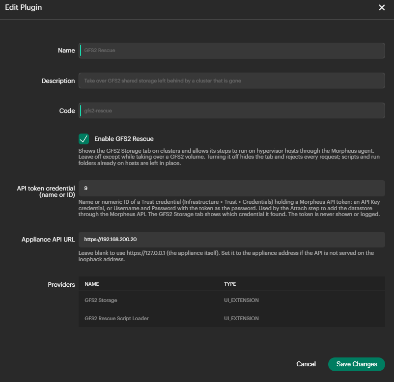
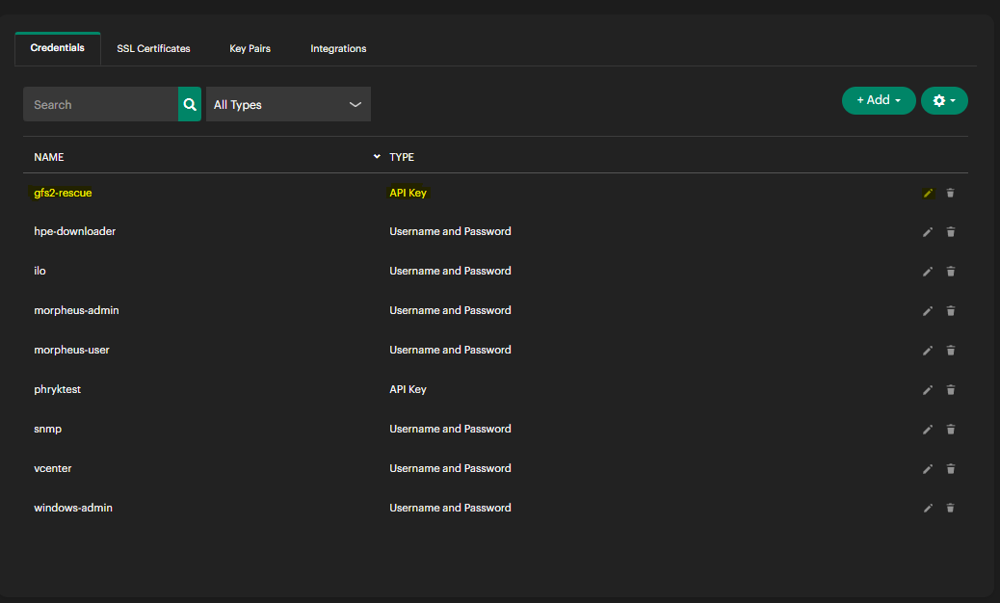

# Install and settings

## Requirements

**Appliance:** Morpheus 9.1.0 or later. The user running steps needs the `admin-cm` permission at
full access (the same permission that manages clusters).

**Hosts:** every hypervisor host in the cluster needs:

- The Morpheus agent.
- `tunegfs2`, `fsck.gfs2`, `gfs2_edit` (gfs2-utils), `dlm_tool`, `qemu-img`, `blkid`, `lsblk`,
  `findmnt`, `uuidgen`, `flock`, `sha256sum` and `systemd-run`. HVM hosts have these already.
- `iscsiadm` is used by Rescan storage if it is installed; it is optional.

**Storage:** the GFS2 LUN presented to the hosts through multipath, so it appears as
`/dev/mapper/<wwid>`.

## Build

The pins match HPE's own 9.1 plugins: plugin-api 1.5.0, morpheus-plugin-gradle 1.2.8,
Groovy 4.0.31, Java 25, Gradle 9.x.

Linux or macOS:

```
sdk use java 25-tem
sdk use gradle 9.1.0
gradle clean shadowJar --no-daemon
```

Windows (PowerShell), once:

```powershell
winget install EclipseAdoptium.Temurin.25.JDK
# Gradle 9.1.0: extract https://services.gradle.org/distributions/gradle-9.1.0-bin.zip to C:\gradle
```

Each session:

```powershell
$env:JAVA_HOME = (Get-ChildItem 'C:\Program Files\Eclipse Adoptium' -Directory | Where-Object Name -like 'jdk-25*' | Select-Object -First 1).FullName
$env:Path = "C:\gradle\gradle-9.1.0\bin;$env:JAVA_HOME\bin;$env:Path"
gradle wrapper --gradle-version 9.1.0      # first time only
.\gradlew.bat clean shadowJar --no-daemon
```

The jar is `build/libs/morpheus-gfs2-rescue-<version>-all.jar`. To confirm it contains everything
it needs:

```powershell
tar -tf (Get-ChildItem build\libs\*-all.jar).FullName | Select-String 'gfs2-rescue\.sh|gfs2RescueClusterTab|gfs2-rescue\.js'
```

You should see `scripts/gfs2-rescue.sh`, `renderer/hbs/gfs2RescueClusterTab.hbs` and
`assets/gfs2-rescue.js`.

Line endings: `.gitattributes` keeps the shell scripts as LF on a Windows checkout, and the plugin
strips any CR from the bundled script when it loads, so a CRLF copy never reaches a host.

## Install or upgrade

Administration → Integrations → Plugins → **Add**, and upload the jar. Uploading a newer version
replaces the old one. Reload the browser page afterwards: the page script is only picked up on a
fresh load.

The appliance log (`/var/log/morpheus/morpheus-ui/current`) gets a line like
`GFS2 Rescue 0.1.8 initialized (bundled script sha256 …)`.

## Settings

Administration → Integrations → Plugins → GFS2 Rescue → edit.



| Setting | What it does | Default |
| --- | --- | --- |
| Enable GFS2 Rescue | Shows the tab and allows steps to run. While off, the tab is hidden on every cluster, its script is not loaded into pages, and every request is refused. | Off |
| API token credential (name or ID) | The Trust credential holding a Morpheus API token. Used only by Attach. | Empty |
| Appliance API URL | Where Attach sends its API calls. | `https://127.0.0.1` |

Settings are re-read every 15 seconds, so changes take effect without a restart.

### Enable only while you need it

The plugin runs commands on hypervisor hosts as root. Turn it on for a takeover and off again once
the volume is attached and verified. Turning it off leaves the helper script and run folders on the
hosts; they are inert without the plugin and are the record of what was done.

### API token credential

Attach adds the datastore through the Morpheus API rather than the Add Data Store dialog, so it
needs a token.

1. Create an API token for an administrator (User settings → API access).
2. Infrastructure → Trust → Credentials → Add. Either type works:
   - **API Key**, with the token as the key.
   - **Username and Password**, any username, the token as the password.
3. In the plugin settings, enter the credential's **name** or its numeric **ID**.

The tab header shows the credential it found, for example `morpheus-api-token (ID 12, API Key)`, or the
reason it could not find one.

The token itself is never shown, logged or sent to the browser.



If two credentials share a name, use the ID.

### Appliance API URL

Leave it blank to call the appliance on its loopback address. If the API is not answered there
(for example when the UI is only bound to the appliance's own address), set it to that address,
such as `https://<appliance address>`. The appliance's own certificate is accepted.

## Uninstall

Administration → Integrations → Plugins → GFS2 Rescue → delete. To remove what it left on the hosts,
run on each host:

```
sudo rm -rf /opt/gfs2-rescue
sudo rm -rf /var/lib/gfs2-rescue
```

Keep `/var/lib/gfs2-rescue` until you no longer need the evidence of past takeovers.
