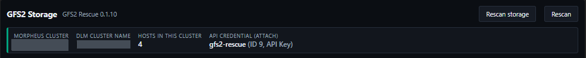
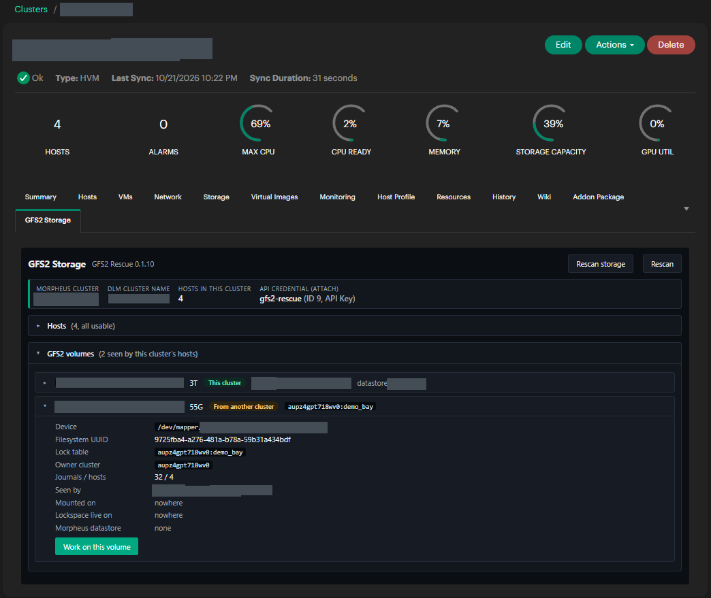
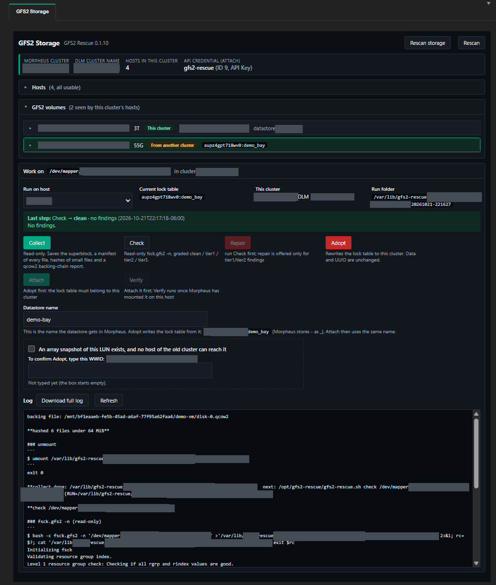
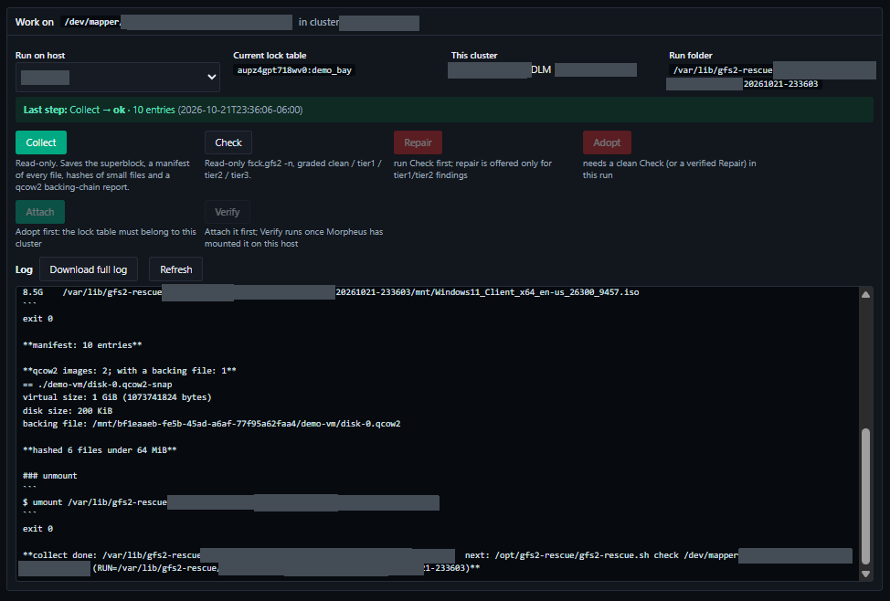
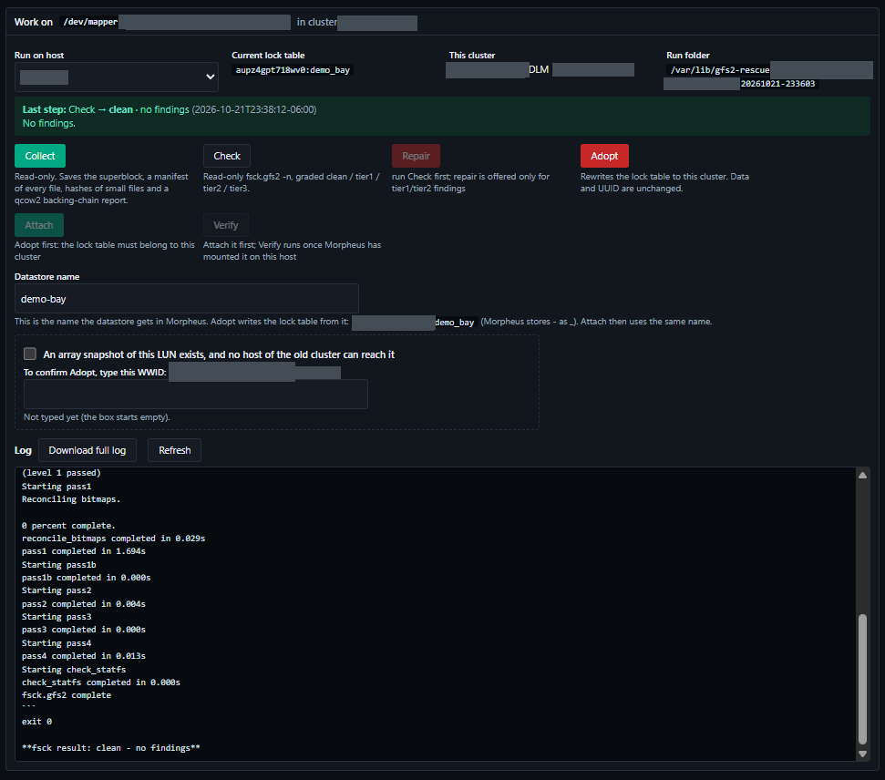
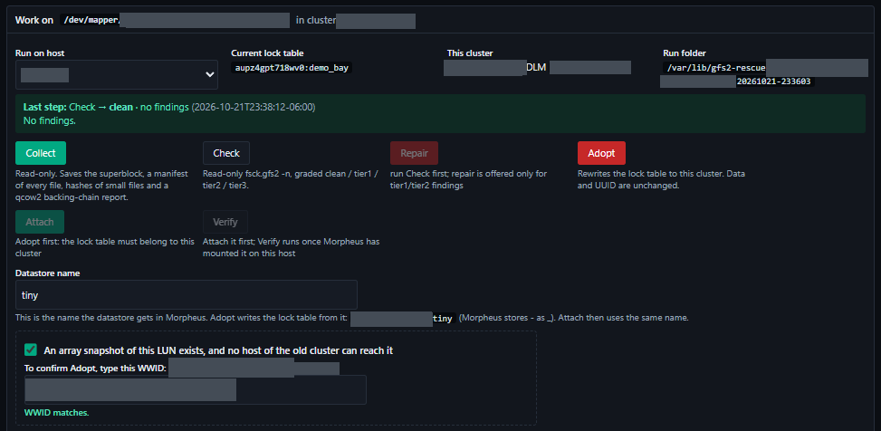
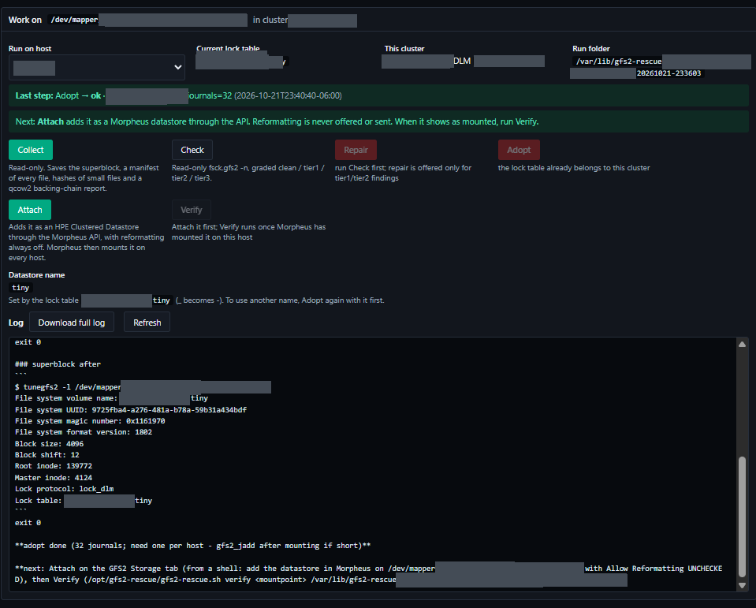
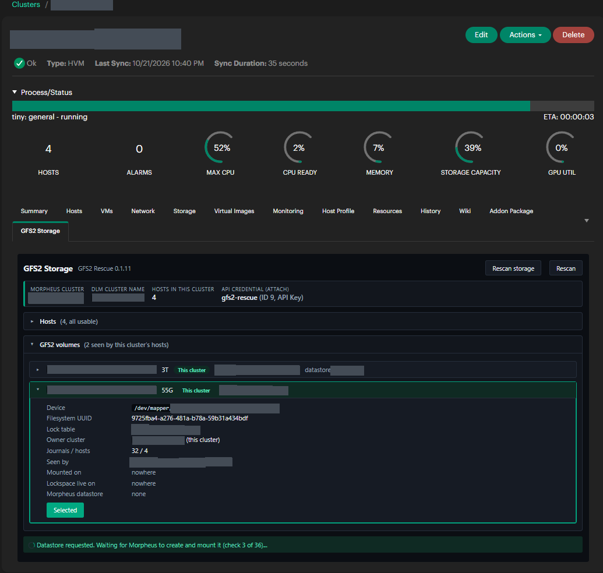
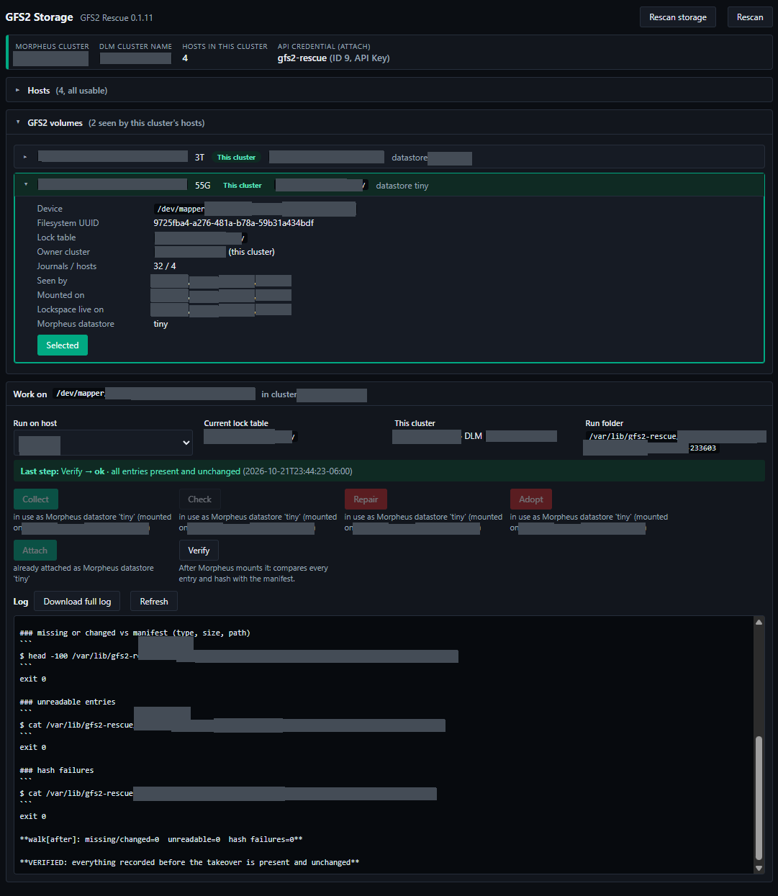
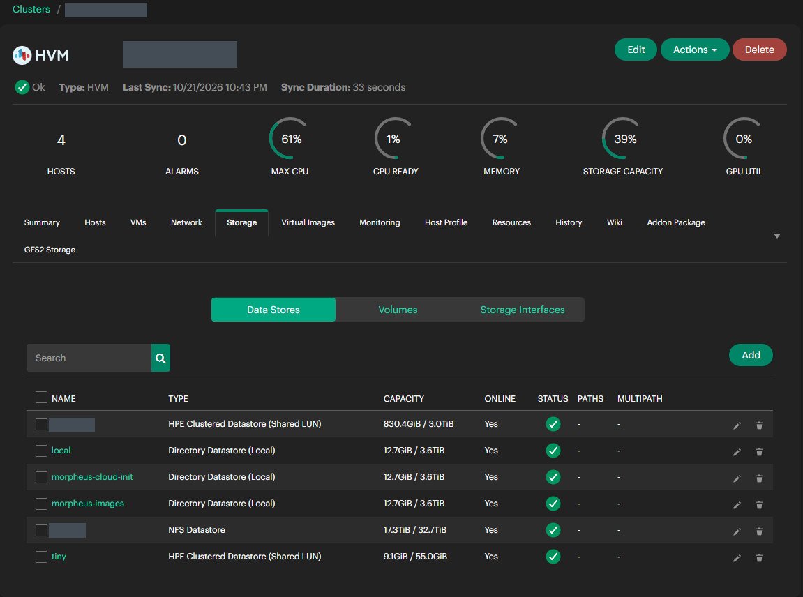

# Takeover walkthrough

This is the normal path: a GFS2 LUN from a cluster that no longer exists, now presented to the
hosts of your current cluster. For a snapshot presented alongside its original, start with
[Snapshots and duplicate UUIDs](06-snapshots-and-duplicates.md) instead.

## Before you start

1. **Take an array snapshot of the LUN.** Every writing step asks you to confirm one exists. It is
   the only way back if something goes wrong on the array side.
2. **Make sure no host of the old cluster can reach the LUN.** Unpresent it from them on the array,
   or power them off. Two clusters writing to one GFS2 volume corrupt it, and nothing on the new
   cluster's side can detect a host it does not know about.
3. **Present the LUN to every host of the new cluster**, through multipath.
4. **Turn the plugin on** (plugin settings → Enable GFS2 Rescue) and set the API credential if Attach
   is not set up yet. See [Install and settings](02-install-and-settings.md).

If you have never done a takeover with this plugin, rehearse on a scratch LUN first
([Demo LUN](10-demo-lun.md)).

## 1. Open the tab and check you are in the right place

Infrastructure → Clusters → your cluster → **GFS2 Storage**.

The box at the top shows the Morpheus cluster name, the DLM cluster name the hosts report, how
many hosts are in the cluster, and the API credential Attach will use. Check all four.

Open **Hosts**. Every host should show `installed` or `current` under Script, and the same DLM
cluster. A host reporting a different DLM cluster is left out, with a
warning; it contributes nothing and nothing runs on it.

## 2. Find the volume

Open **GFS2 volumes**. Each row shows the multipath WWID, size, a badge, the lock table, and the
Morpheus datastore if it is one already.

| Badge | Meaning |
| --- | --- |
| From another cluster | The lock table names a different cluster. This is what you take over. |
| This cluster | The lock table already names this cluster. |
| In use | Mounted, or its lockspace is live, somewhere in the cluster. |
| Step running | A step is running for this volume on one of the hosts. |
| Duplicate UUID | Another LUN has the same filesystem UUID. See [Snapshots and duplicate UUIDs](06-snapshots-and-duplicates.md). |

If the LUN is not listed, click **Rescan storage**. It asks each host to look for new LUNs and
then scans again. If it is still missing, check multipath on a host (`multipath -ll`).

Expand the volume and click **Work on this volume**. The work panel opens below with a **Run on
host** picker. Any host that sees the volume works; pick one and keep it for the whole takeover,
because the run folder with the evidence lives on that host.

Every button that cannot run says why underneath it.

## 3. Collect

Click **Collect**. It is read-only. It mounts the volume read-only with local locking on the chosen
host, saves the first 128 KiB (the superblock region), lists every file and directory with type,
size and modification time, hashes every file under 64 MiB, records the backing chain of every
qcow2 image, and unmounts.

The log refreshes every 5 seconds while it runs. Collect on a large volume can take a while; the
step runs on the host independently of your browser, so you can leave the page.

Look at the qcow2 section of the log. An overlay whose backing file points at
`/mnt/<old-uuid>/...` names the old cluster's mount path; those VMs need their disk paths fixed
after the takeover.

## 4. Check

Click **Check**. It runs `fsck.gfs2 -n`, which changes nothing, and grades the result:

| Result | Meaning | Next |
| --- | --- | --- |
| clean | No findings | Adopt |
| tier1 | Accounting leftovers from an unclean shutdown: unowned data blocks, free counts, statfs | Repair |
| tier2 | Inode accounting findings | Repair, then read its walk results carefully |
| tier3 | Structural damage | Stop. Repair only on a clone of the array snapshot, with someone reviewing it |

## 5. Repair (only if Check found tier1 or tier2)

Tick the snapshot box, type the WWID shown in the label until it says **WWID matches**, and click
**Repair**. It runs `fsck.gfs2 -y`, checks again (the result must now be clean), then mounts the
volume read-only and walks it against the Collect manifest and hashes, before any cluster mounts it.

- **Repair → ok**: everything recorded by Collect is present, readable and unchanged.
- **Repair → issues**: the log lists entries that are missing, changed or unreadable. An
  unreadable entry is usually a directory entry naming an inode the repair freed. Restore those
  files from another copy if they matter. Adopt then needs an extra tick to accept them.

## 6. Adopt

The panel shows a **Datastore name** field, prefilled from the volume's current filesystem name,
and underneath it the exact lock table Adopt will write: `<DLM cluster name>:<name with - as _>`.
Morpheus derives the lock table from the datastore name this way, so the two must agree. Use
letters, digits and hyphens, up to 30 characters.

Tick the snapshot box, type the WWID, and click **Adopt**. The confirmation shows the datastore name
and the new lock table. Adopt runs `fsck.gfs2 -n` once more (it must be clean), saves the superblock
if Collect did not, sets the lock protocol to `lock_dlm`, writes the new lock table, and reads it
back. Data, UUID and journals are not changed.

Afterwards the badge changes to **This cluster** and the panel suggests Attach.

## 7. Attach

Click **Attach**. The datastore name is fixed by the lock table, so it is shown, not editable.
The plugin calls the Morpheus API to add an HPE Clustered Datastore on this device with
reformatting off, then rescans every 10 seconds until Morpheus has created the datastore and
mounted it on the hosts. Morpheus shows its own progress bar at the top of the cluster page
meanwhile.

"Last step" shows **Attach → requested**, then **Attach → ok** with how many hosts have it mounted.

## 8. Verify

Pick a host the datastore is mounted on (the one you used for Collect is best, since the run folder
is there) and click **Verify**. It walks the mounted datastore and compares every entry and hash
with the Collect manifest.

**Verify → ok** ends with "VERIFIED: everything recorded before the takeover is present and
unchanged". The takeover is done.

If Verify reports issues, the lists in the log say exactly which entries. Do not delete an
unreadable entry while the volume is mounted; it needs an offline `fsck.gfs2 -y`.

## Afterwards

- The volume shows as **This cluster** with its datastore name, and every step except Verify is
  refused because it is in use.
- Check journals: the tab warns if there are fewer journals than hosts. Add them with `gfs2_jadd`
  on the mounted filesystem if needed.
- VMs on the volume are not yet known to Morpheus. Their disks are on the new datastore; define
  them on a host and convert them to managed, fixing any disk paths that named the old mount.
- Download the full log (**Download full log**) and keep it with the change record.
- Turn the plugin off in its settings.

