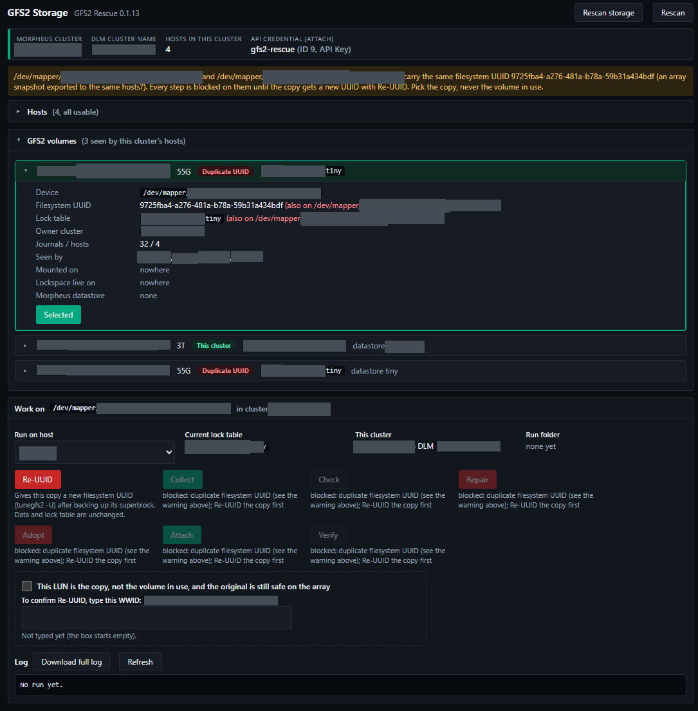
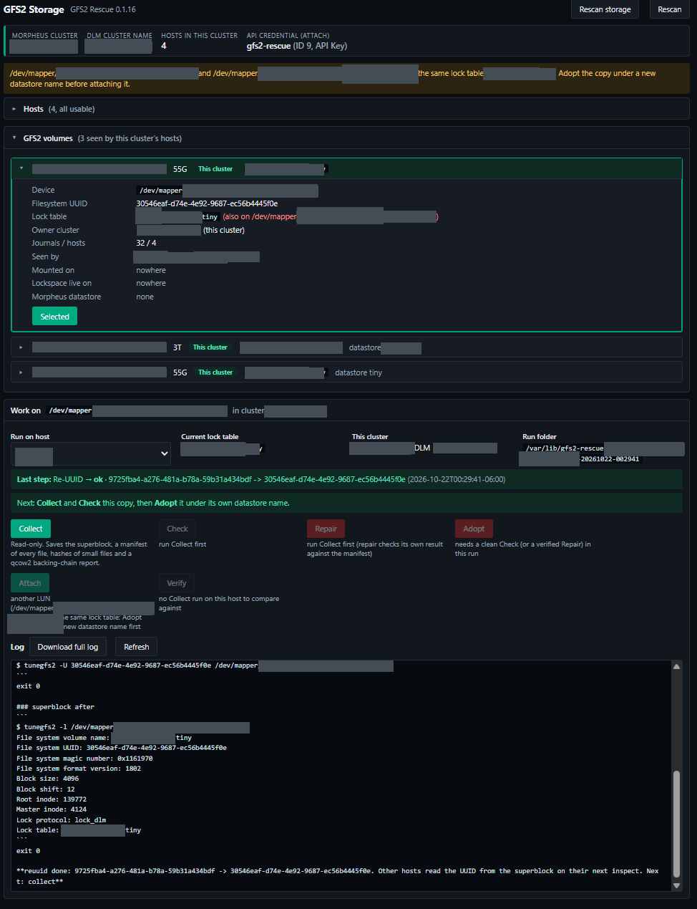
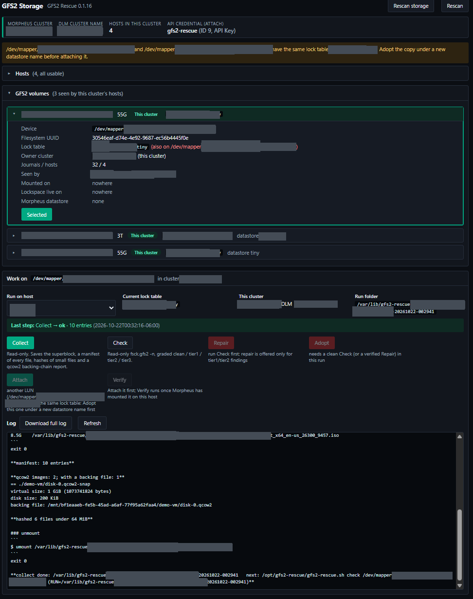
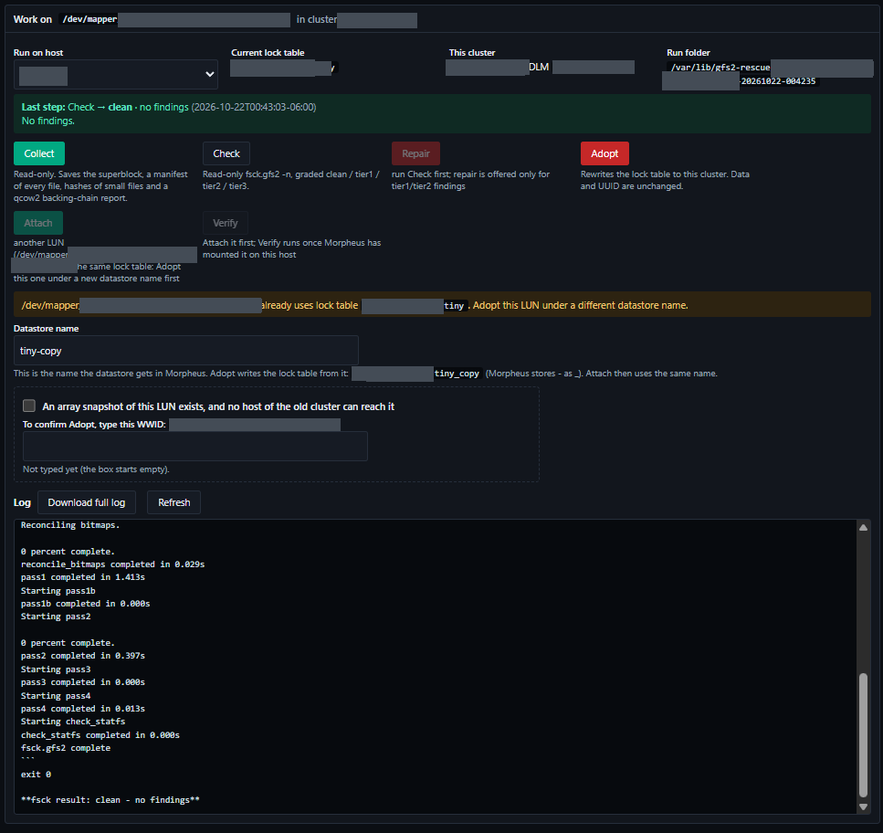
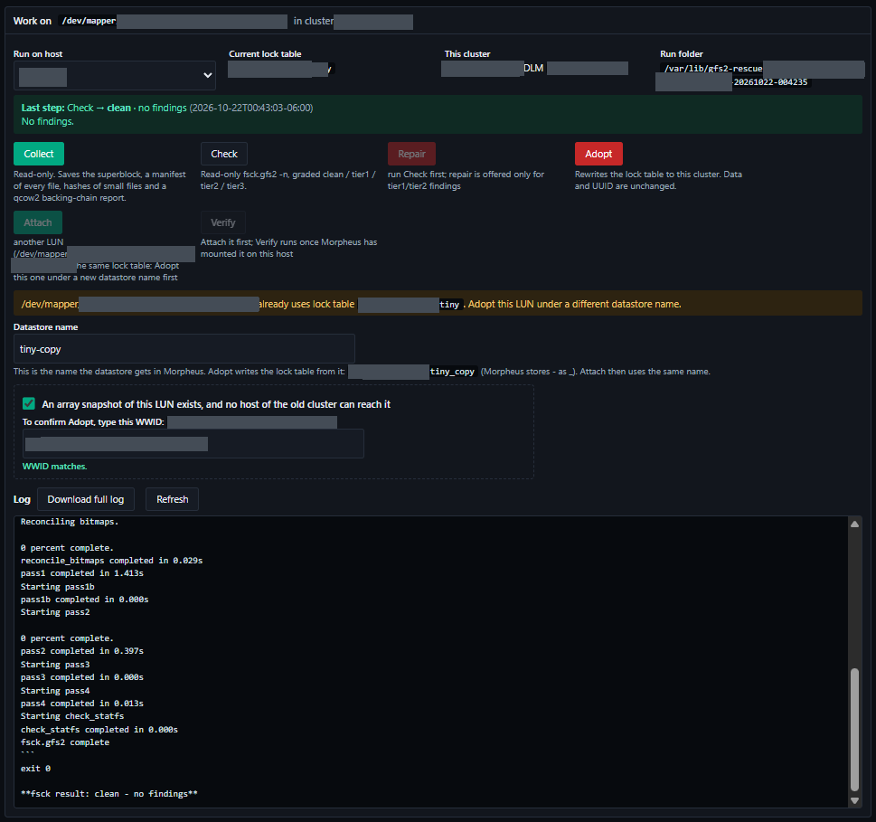
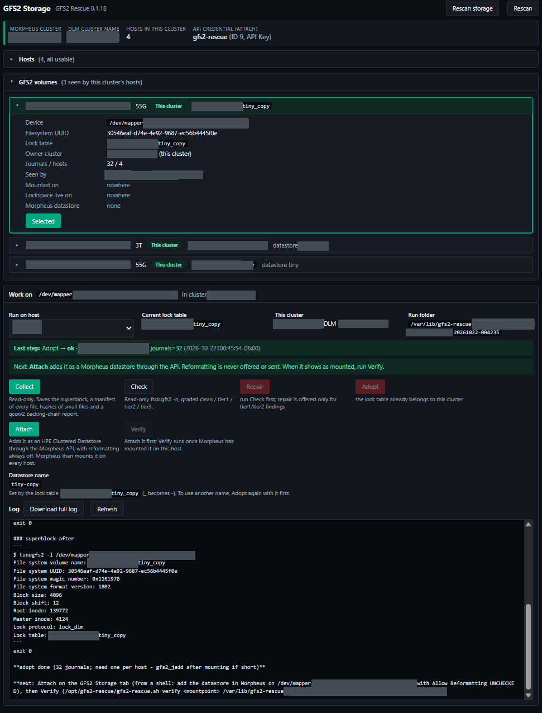
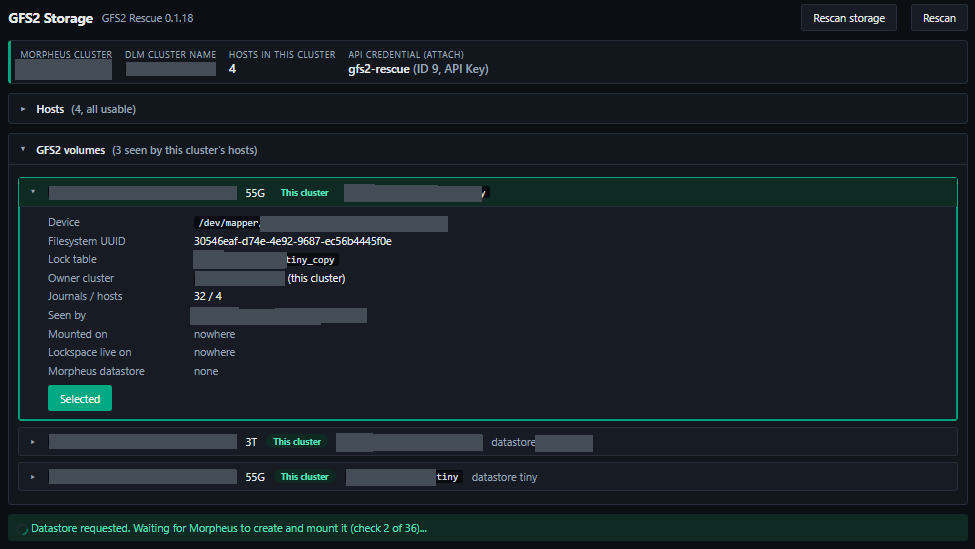
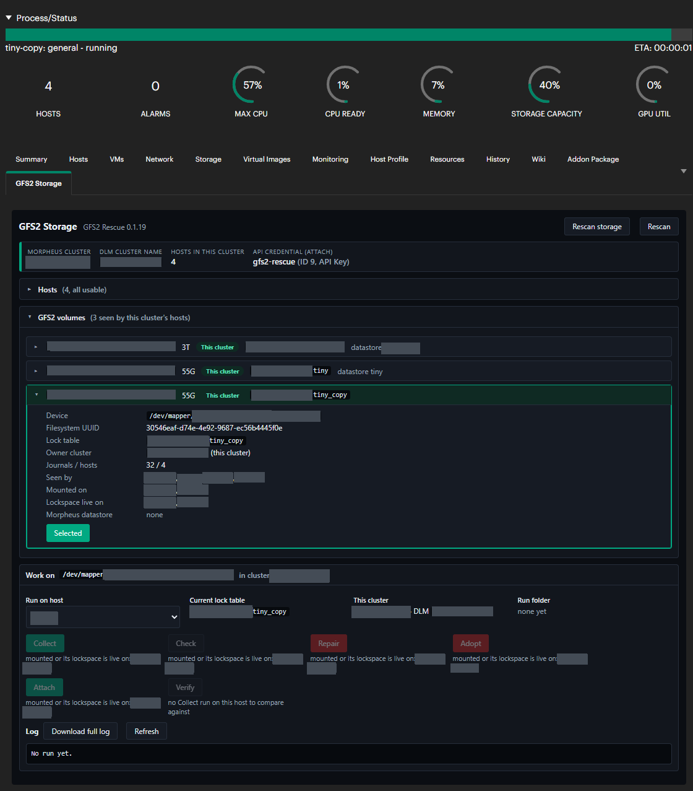
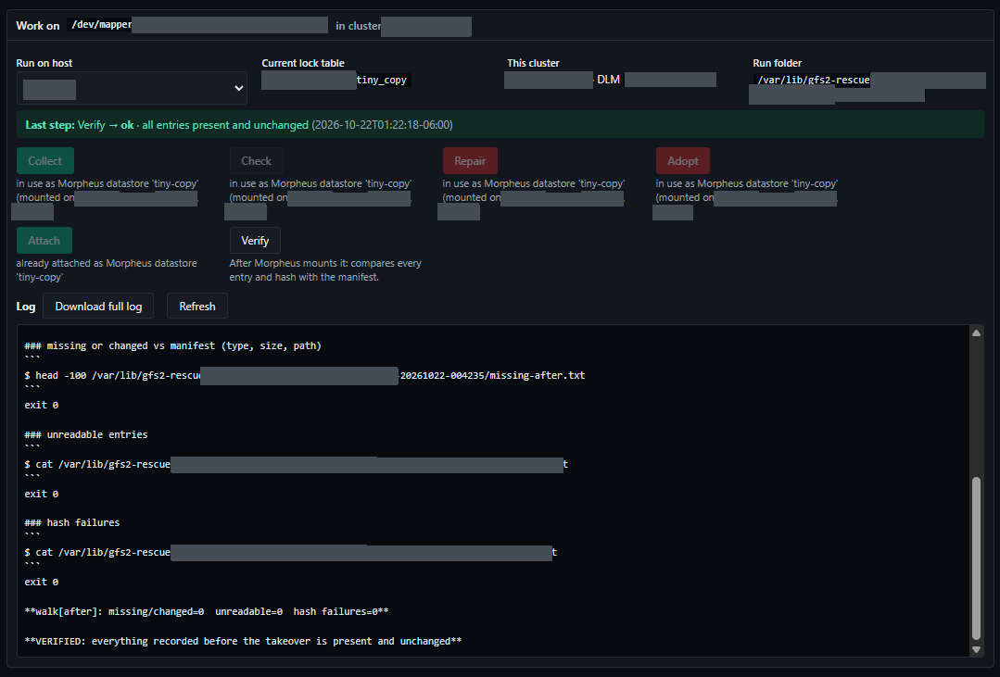

# Snapshots and duplicate UUIDs

## When this applies

An array snapshot (or clone) of a GFS2 LUN is a block-for-block copy, so it carries the original's
filesystem UUID and lock table. That is harmless while the copy is presented to a different
cluster, which is the normal disaster-recovery case: the takeover there is the ordinary
[walkthrough](03-takeover-walkthrough.md).

It is not harmless when the copy is presented to the **same hosts** as the original, for example to
pull files out of last night's snapshot. Two block devices with one filesystem UUID confuse anything
that finds filesystems by UUID, and two GFS2 filesystems with one lock table would try to share one
DLM lockspace if both were mounted.

## What the tab shows

- Both LUNs are listed as separate rows (they are told apart by multipath WWID).
- Both get the **Duplicate UUID** badge, and their details say which other device carries the
  same UUID and the same lock table.
- A warning at the top names the pair.
- Every step is refused on both, except **Re-UUID**.
- Re-UUID is refused on whichever LUN is mounted or is a Morpheus datastore. That one is the
  original; the copy is the other one.



## Taking over the copy

1. **Re-UUID the copy.** Select the LUN that is not in use, pick a host, tick "This LUN is the copy,
   not the volume in use, and the original is still safe on the array", type its WWID, and click
   **Re-UUID**. It saves the superblock region, gives the filesystem a new random UUID, and reads it
   back. Nothing else changes.

   

2. **Rescan.** The Duplicate UUID badges disappear. The copy now shows a warning that it shares its
   lock table with the original.
3. **Collect** and **Check** the copy, as in the walkthrough. Collect reuses the Re-UUID run folder,
   so all the evidence stays together. A copy taken while the original was mounted is like a copy
   taken at a power cut; Check grades it like any other volume.

   

   

4. **Adopt under a new name.** The datastore name is prefilled as `<original name>-copy`; change it
   if you like. It must give a lock table no other LUN has, and must not be an existing datastore
   name.

   

   

5. **Attach** and **Verify** as usual. The copy becomes its own datastore next to the original.
   Attach needs the copy on every host of the cluster as a block device; the tab names any host
   that does not have it yet.

   

   

   

6. **Restore what you need.** The copy's VM disks are on its own datastore now. Copy a disk back, or
   define the VM from the copy, then detach and remove the copy's datastore when you are done.

Some arrays present a copy under a new WWID partway through, for example when a clone is re-created
or split from its parent. The filesystem is unchanged, and the tab carries the run over to the new
WWID by filesystem UUID, so Verify still compares against the copy's own Collect.

## If both are unmounted

Neither is blocked as "in use", so Re-UUID is offered on both. Make sure you pick the copy. If you
are not sure which is which, check the array: the WWID in the tab is the LUN's identifier there.
Re-UUIDing the original instead does no harm to its data, but anything that refers to it by its old
UUID would then find the copy. That includes a Morpheus datastore for it, whose path is
`/mnt/<old uuid>`: the tab only recognises a datastore while it is mounted, so an unmounted one
does not block Re-UUID.

## From a shell

```
sudo /opt/gfs2-rescue/gfs2-rescue.sh reuuid /dev/mapper/<copy wwid>
```

Without `--yes` it asks you to type `REUUID`. It refuses if the device is mounted on the host, or if
the copy's lockspace name is live and the mounted original cannot be found on that host.
